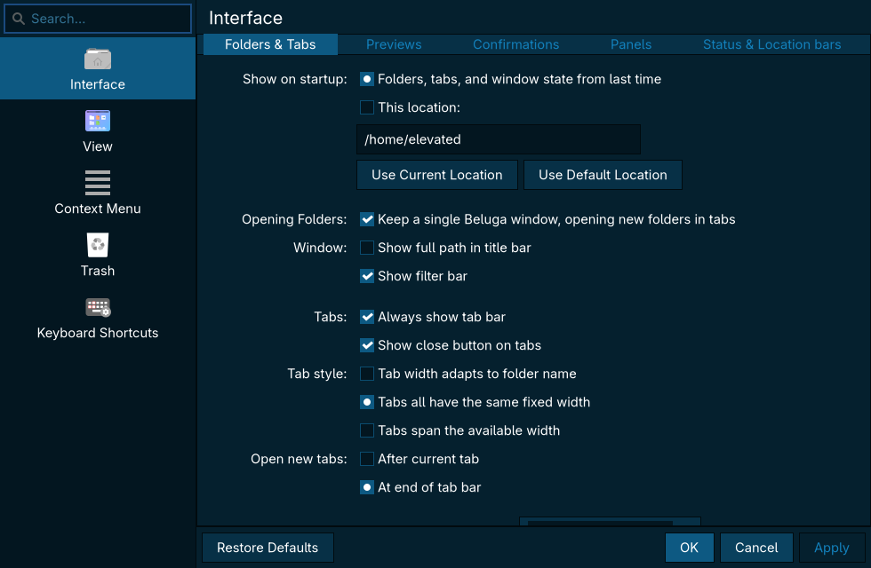
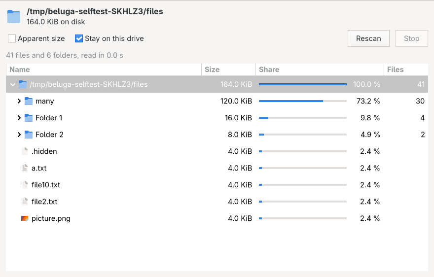

# Beluga


<p align="center"></p>

A file manager for Linux written in C++ with plain GTK 4. It is a rewrite of KDE's Dolphin: the same views,
panels, tabs, split view and shortcuts, without Qt, KDE Frameworks or libadwaita.

Beluga contains no Dolphin code. Settings that KDE kept in System Settings (click behaviour, terminal, trash
limits, places) live in Beluga's own preferences.


## List of Contents

- **[Parts](#parts)**
- **[Features](#features)**
- **[Requirements](#requirements)**
- **[Installation](#installation)**
  - [Building](#building)
- **[Quick start](#quick-start)**
  - [Command line](#command-line)
  - [Keyboard shortcuts](#keyboard-shortcuts)
  - [Vim mode](#vim-mode)
- **[Beluga as the file chooser](#beluga-as-the-file-chooser)**
- **[Coming from Dolphin](#coming-from-dolphin)**
- **[Settings](#settings)**
- **[Testing](#testing)**
- **[Translating](#translating)**
- **[Known limitations](#known-limitations)**
- **[License](#license)**

## Parts

| Part | Binary / file | Use it for |
|---|---|---|
| File manager | `beluga` (window class `Beluga`) | browsing and managing files |
| Engine | `belugacore` (static library) | file operations, trash, search, previews, places, devices, settings (GLib/GIO only) |
| Desktop entry | `org.beluga.Beluga.desktop` | launchers and "open folder" from other apps |
| File chooser | `beluga --portal`, `beluga.portal` | the Open and Save dialogs of other programs, through xdg-desktop-portal |

## Features

- **Views**: Icons, Compact, Details and Columns (<kbd>Ctrl</kbd>+<kbd>1</kbd>–<kbd>4</kbd>) in one virtualised
  widget, so folders with 100 000 items scroll without delay. Details has resizable columns and expandable
  folders. Columns shows each parent folder in its own column. All views can group items by name, size, date,
  type and other columns. Folders share one view style, and **View → Remember View for This Folder** gives a
  folder its own view mode, sorting and columns.
- **Tabs and split view**: tabs with drag-to-reorder, detach and "recently closed"; two views side by side
  (<kbd>F3</kbd>) with copy/move to the other view (<kbd>Shift</kbd>+<kbd>F5</kbd> / <kbd>F6</kbd>).
- **Panels**: Places (<kbd>F9</kbd>), Folders tree (<kbd>F7</kbd>) and Information (<kbd>F11</kbd>, with
  previews, image dimensions, playback, folder sizes, and for audio and video what `ffprobe` shows: duration,
  format, bit rate, tags such as title, artist and album, and each stream's codec, size, frame rate, sample rate
  and channels, read with FFmpeg's libavformat). **View → Show Statusbar** hides or shows the status bar (zoom
  slider, free space); give it a shortcut in **Configure Beluga → Keyboard Shortcuts**.
- **File operations**: copy, move, link, rename (inline or batch with `#` numbering), duplicate, trash and delete
  run in worker threads with a progress button in the tool bar, conflict dialogs (skip, overwrite, rename, write
  into) and undo/redo.
- **Trash without gvfs**: browse, restore and empty the freedesktop.org trash, including trash folders on other
  drives. Optional age and size limits, and **Keep the trash on the home drive** so other drives get no
  `.Trash-1000` folder.
- **Folder icons**: pick an icon or an image for a folder in its Properties (saved in `.directory`, as Dolphin
  does); Beluga shows the icons `.directory` files set.
- **Archives as folders**: zip, tar (`.tar.gz`, `.tar.xz`, `.tar.zst`, …), 7z, rar and ISO images can be browsed
  like folders, through libarchive and without gvfs or Ark. By default a double-click opens an archive in its
  program (Ark, File Roller, …) and **Open in Beluga** in its context menu browses it; with **Configure Beluga →
  View → General → Browse compressed files as folders** a double-click browses it and **Open With** offers the
  programs. Archives
  without a program always open in Beluga. They are read only: copy or drag entries out to extract them, and
  double-click a file to open an extracted copy. Entries with `..` or absolute paths are never written outside the
  target folder.
- **Search without Baloo**: by name (wildcards work), by text content, file type and modification date, from the
  current folder, your home folder or everywhere. Name and type searches in your home folder answer from Beluga's
  own index of names, like Everything, hidden folders included. Measured on a home folder with 1.6 million
  indexed names (warm disk cache): a search takes about 10 ms, or 32 ms with hidden files; `find ~ -xdev -iname`
  with the same pattern takes 0.78 s. The index needs no daemon: before showing more results it reads again only
  the folders whose time changed (about 70 ms when nothing changed), and every hit is checked on the disk, so
  deleted files never show. The cache folder (`~/.cache`) and other drives mounted inside your home folder aren't
  indexed; searches read them from the disk. The index takes about 140 MB of memory for these 1.6 million names
  and 84 MB in `~/.cache/beluga`, and can be turned off in **Configure Beluga → View → General**. Other searches
  (contents, dates, sizes) read the folders on all CPU cores; results stream in while the search runs.
- **Disk Usage** (the tool bar's Disk Usage button or <kbd>Shift</kbd>+<kbd>F11</kbd> for a pane on the right that
  follows the folder you're in; <kbd>Ctrl</kbd>+<kbd>Shift</kbd>+<kbd>U</kbd>, **Tools → Disk Usage…** or a
  folder's context menu for a window of its own):
  what takes up the space in a folder, as a tree with the biggest items first, like
  [dust](https://github.com/bootandy/dust). It reads folders the way dust does, on all CPU cores, and counts hard
  links once: 2 million files under `/usr` take 0.3 s with a warm cache (dust: 1.4 s, `du`: 2.6 s), with the
  same total as `du`. Shows disk usage or file sizes. Links are never followed, and **Stay on this drive** leaves
  out other drives mounted inside the folder (a music folder on another disk, say), also in the Disk Usage column,
  which shows "other drive" for them. Double-click an entry to open it.
  Folder sizes in the views and in Properties use the same reader. Results are remembered: the window shows the
  last scan of a folder (or of one above it) at once and reads again only after 10 minutes or on **Rescan**, and
  remembered folder sizes stay in `~/.cache/beluga` until the folder changes. **Configure Beluga → View → Details → Show a
  Disk Usage column** adds the same numbers to the Details view: every file and whole folder with its size on disk
  and a bar for its share of the folder; sort by the column to see the biggest first.
- **Previews**: the shared freedesktop thumbnail cache, filled by gdk-pixbuf, the system's `.thumbnailer`
  programs and Tumbler when installed.
- **Devices**: drives and partitions from UDisks2 with usage bars, mount, unmount and safe removal.
- **Terminal**: <kbd>F4</kbd> opens your terminal in the current folder. The command is a Beluga setting; when it
  is empty Beluga uses `$TERMINAL` or the first installed terminal it knows (kitty, foot, alacritty, …).
- **Custom actions**: your own context menu entries (name, icon, command with `%f %F %n %d` placeholders, file
  patterns and types). They replace KDE service menus. "Extract Here" and "Compress to .tar.gz" are included.
- **Integration**: drag and drop with other apps, a clipboard other GTK and KDE file managers understand, and the
  `org.freedesktop.FileManager1` D-Bus service browsers use for "Show in folder".
- **Act as Administrator** (**View** menu): asks for the administrator password with polkit's prompt (`pkexec`)
  and opens a second Beluga window that runs as root, marked by a warning bar and "(Administrator)" in its title.
  It uses your theme. `sudo beluga` works too: a root Beluga finds your Wayland display and gets a D-Bus session
  of its own.
- **File chooser for other programs**: an xdg-desktop-portal backend, like the KDE one that uses Dolphin: Places,
  the folder in a Beluga view, name, file types and the program's own options. See
  [Beluga as the file chooser](#beluga-as-the-file-chooser).
- **Translations**: 63 languages. Czech, Slovak, German, French, Spanish, Italian, Brazilian Portuguese, Polish,
  Russian, Ukrainian, Dutch, Japanese and Simplified Chinese are complete (805 of 806 messages). The other 50 have
  24–46% of the messages, taken from Dolphin, KDE Frameworks and GTK where the English text is the same; the rest
  is shown in English.
- **Vim mode** (off by default): h j k l, counts, three visual modes (each item the cursor passes, a range, a block
  of the grid), y / d / dd / p, the leader key and a `:` command line. See [Vim mode](#vim-mode).
- **Look**: laid out like Dolphin: Back, Forward, Up and the view mode left of the location bar (two side by side in
  split view), Disk Usage, Split, Sort, Search and the menu right of it, all in one tool bar that **Settings →
  Configure Toolbars…** (or a right click on it) changes, as in Dolphin; tabs of one fixed width that all get narrower by the same amount when
  they don't fit (or as wide as their names);
  "Zoom:" and the free space in the status bar. **Configure Beluga** has Dolphin's pages (Interface, View, Context
  Menu, Trash) and tabs, with a search field, **Restore Defaults**, **OK**, **Cancel** and **Apply**. Colours come
  from your GTK theme's named colours (pywal and Noctalia style sheets work), square corners, no titlebar of its
  own.






## Requirements

- GTK 4.16 or newer, GLib 2.84 or newer, gdk-pixbuf, libarchive 3.6 or newer
- To build: a C++17 compiler, CMake 3.16, pkg-config, gettext (`msgfmt`, for the translations)
- Optional when building: FFmpeg's libavformat, libavcodec and libavutil (audio and video details in the
  Information panel). `-DBELUGA_FFMPEG=AUTO` (the default) uses them when found, `ON` requires them, `OFF` leaves
  them out.
- Optional at run time: UDisks2 (devices), Tumbler or `.thumbnailer` programs (video/PDF previews), gvfs
  (network locations such as `sftp://`), `bsdtar` (the "Extract Here" action), polkit with a polkit agent
  (**Act as Administrator**)

## Installation

| Package | Contents |
|---|---|
| [`beluga-bin`](https://aur.archlinux.org/packages/beluga-bin) | the release binary from GitHub |
| [`beluga-git`](https://aur.archlinux.org/packages/beluga-git) | built from the latest commit |

Other distributions: download `beluga-<version>-linux-x86_64.tar.gz` from the
[releases](https://github.com/TheElevatedOne/beluga/releases) and copy its `bin/` and `share/` folders into `/usr`
or `~/.local`, or build it.

### Building

```sh
# Arch:   sudo pacman -S base-devel cmake gtk4 libarchive ffmpeg gettext
# Debian: sudo apt install build-essential cmake pkg-config gettext libgtk-4-dev libarchive-dev libavformat-dev
# Fedora: sudo dnf install gcc-c++ cmake gettext gtk4-devel libarchive-devel ffmpeg-free-devel
cmake -S . -B build -DCMAKE_BUILD_TYPE=Release
cmake --build build
sudo cmake --install build
```

`-DBELUGA_INSTALL_FILEMANAGER1_SERVICE=ON` also installs a D-Bus service file, so "Show in folder" starts Beluga when it
isn't running. Leave it off if another file manager should own that service.

## Quick start

Run `beluga` to open your home folder (or the tabs of your last session). Run `beluga ~/Downloads` to open a folder,
or `beluga --select ~/Downloads/file.zip` to open its folder with the file selected. From a terminal,
`beluga --detach` opens the current folder and gives you the prompt back at once; Beluga keeps running when the
terminal closes.

### Command line

```text
Usage:
  beluga [OPTION…] [FILE or FOLDER…]

Application Options:
  -s, --select              Select the given files in their folders
  --split                   Open the window in split view
  --new-window              Always open a new window
  --daemon                  Keep running in the background for the FileManager1 D-Bus service
  --detach                  Detach from the terminal (without a location: open the current folder)
  --portal                  Run the file chooser for xdg-desktop-portal (started by D-Bus)
  -v, --version             Show the version
```

A second `beluga` call opens a new window in the running instance, or a new tab when **Configure Beluga → Interface →
Folders & Tabs → Keep a single Beluga window, opening new folders in tabs** is on.

### Keyboard shortcuts

| Keys | Action |
|---|---|
| <kbd>F2</kbd> / <kbd>Del</kbd> / <kbd>Shift</kbd>+<kbd>Del</kbd> | rename / move to trash / delete |
| <kbd>F3</kbd> / <kbd>F4</kbd> | split view / open terminal |
| <kbd>F5</kbd> / <kbd>F6</kbd> / <kbd>Ctrl</kbd>+<kbd>L</kbd> | reload / editable location / replace location |
| <kbd>Ctrl</kbd>+<kbd>1</kbd> … <kbd>Ctrl</kbd>+<kbd>4</kbd> | Icons / Compact / Details / Columns view |
| <kbd>F7</kbd> / <kbd>F9</kbd> / <kbd>F11</kbd> | Folders / Places / Information panel |
| <kbd>Shift</kbd>+<kbd>F11</kbd> | Disk Usage pane |
| <kbd>F10</kbd> | new folder |
| <kbd>Ctrl</kbd>+<kbd>I</kbd> or <kbd>/</kbd> / <kbd>Ctrl</kbd>+<kbd>F</kbd> | filter bar / search |
| <kbd>Ctrl</kbd>+<kbd>H</kbd> | show hidden files |
| <kbd>Ctrl</kbd>+<kbd>T</kbd> / <kbd>Ctrl</kbd>+<kbd>W</kbd> / <kbd>Ctrl</kbd>+<kbd>Shift</kbd>+<kbd>T</kbd> | new tab / close tab / reopen closed tab |
| <kbd>Space</kbd> | selection mode |
| <kbd>Alt</kbd>+<kbd>←</kbd> / <kbd>Backspace</kbd> / <kbd>Alt</kbd>+<kbd>↑</kbd> | back / back / up |
| <kbd>Ctrl</kbd>+<kbd>M</kbd> | show the menu bar |
| <kbd>Ctrl</kbd>+<kbd>Shift</kbd>+<kbd>U</kbd> | Disk Usage of the selected or current folder |
| <kbd>Ctrl</kbd>+<kbd>Shift</kbd>+<kbd>,</kbd> | Configure Beluga |

Every shortcut can be changed in **Configure Beluga → Keyboard Shortcuts**. Typing a name in a view jumps to the
first matching item.

### Vim mode

Turn it on in **Configure Beluga → Vim Mode** (it is off by default). The views then take Vim-like keys; text
fields (renaming, the location bar) keep typing normally, and keys with <kbd>Ctrl</kbd> or <kbd>Alt</kbd> that Vim
mode doesn't use keep their usual meaning. A line at the bottom of the window shows the mode and the keys typed so
far. Every key sequence below can be changed on the same page; `<leader>` is <kbd>Space</kbd> unless you pick
another key.

| Keys | Action |
|---|---|
| `h` `j` `k` `l`, arrows | move (with a count: `5j`) |
| `gg` / `G`, `Ctrl+d` / `Ctrl+u` | first / last item, half a page down / up |
| `Enter` / `-` | open / go to the parent folder |
| `H` / `L`, `gh` | back / forward, home |
| `v` | select every item the cursor passes |
| `V` | select a range, like <kbd>Shift</kbd> (in reading order, across lines) |
| `Ctrl+v` | select a block of the grid (right one and down one from the top left: the four items in that corner) |
| `Esc` | back to normal mode |
| `y` / `yy` | copy the selection / the item under the cursor |
| `d` / `dd` / `D` | cut / move to the trash / delete |
| `p` / `P` | paste / paste into the folder under the cursor |
| `i` / `a` / `cw` | rename with the cursor at the start / after the name / with the name selected (insert mode) |
| `o` / `O` | create a folder / a file |
| `u` / `Ctrl+r` | undo / redo |
| `/`, `<leader>/` | filter, search |
| `gt` / `gT`, `qq`, `ZZ` | next / previous tab, close the tab, close the window |
| `<leader>t` / `<leader>s` / `<leader>h` | new tab / split view / hidden files |
| `<leader>d` / `<leader>i` / `<leader>p` | Disk Usage pane / Information panel / Places panel |
| `K` | properties |
| `:` | the command line |

Commands: `:q` closes the window (`:q!` without asking about its tabs), `:qa` (`:qa!`) quits Beluga, `:e PATH` or
`:cd PATH` opens a folder, `:tabnew [PATH]`, `:tabclose`, `:tabonly`, `:sp` / `:vs [PATH]` split the view, `:only`,
`:mkdir NAME`, `:touch NAME`, `:set hidden` / `nohidden` / `hidden!`, `:set view=details`, `:sort size`, `:pwd`,
`:term`, `:du`, `:help`, and `:!COMMAND` runs a shell command in the folder.

## Beluga as the file chooser

Programs that open and save files through xdg-desktop-portal can get Beluga's dialog instead of the GTK or KDE one.
Installing Beluga adds the backend (`/usr/share/xdg-desktop-portal/portals/beluga.portal` and a D-Bus service that
starts `beluga --portal`), but nothing uses it until you pick it. In `~/.config/xdg-desktop-portal/portals.conf`:

```ini
[preferred]
default=hyprland;gtk
org.freedesktop.impl.portal.FileChooser=beluga
```

Keep your own `default=` line, then restart the portal: `systemctl --user restart xdg-desktop-portal`.

Flatpak programs always use the portal. Others need to be told: Firefox with `widget.use-xdg-desktop-portal.file-picker`
set to `1` in `about:config`, GTK 4 programs with `GDK_DEBUG=portals`, GTK 3 programs with `GTK_USE_PORTAL=1`, Qt
programs with `QT_QPA_PLATFORMTHEME=xdgdesktopportal`.

The dialog remembers its last folder, size and view in `~/.config/beluga/filechooser.conf`. It never changes the view
settings of your folders or Beluga's own settings.

## Coming from Dolphin

- **Removed**: the embedded Konsole panel, the Help menu, KDE-only actions (KFind, Kompare, Filelight, activities,
  stash, Get New Stuff), Baloo tags/ratings/comments and version control plugins.
- **Changed**: **Act as Administrator** opens a separate root window through `pkexec` instead of Dolphin's
  `admin:/` KIO worker, and Beluga doesn't refuse to run under `sudo`.
- **Moved into Beluga**: single/double click behaviour, the terminal command, trash limits, places and keyboard
  shortcuts. **Disk Usage** takes the place of Filelight.
- **Places**: on the first start Beluga copies your entries from `~/.local/share/user-places.xbel` (Dolphin's
  places) or GTK bookmarks. After that it keeps its own list.
- **View properties** are stored in Beluga's data folder instead of `.directory` files inside your folders.

## Settings

Beluga creates its files the first time it needs them. Everything can be changed in **Configure Beluga**
(<kbd>Ctrl</kbd>+<kbd>Shift</kbd>+<kbd>,</kbd>).

| File | Contents |
|---|---|
| `~/.config/beluga/beluga.conf` | all settings and custom shortcuts |
| `~/.config/beluga/places.conf` | the Places panel |
| `~/.config/beluga/actions.conf` | custom context menu actions |
| `~/.local/share/beluga/viewprops.conf` | view mode, sorting and columns, globally or per folder |
| `~/.local/state/beluga/session.conf` | open windows and tabs, when **Remember open folders and tabs** is on |
| `~/.cache/beluga/` | the name index (`index-v2`), remembered folder sizes (`usage-v1`) and copies of files opened from archives; safe to delete |

## Testing

`beluga --selftest` runs 81 checks of the file operation engine (copy, move, conflicts, trash and restore, undo,
rename, search, sorting, places) and of the window (all four views, filter, navigation, split view, tabs, search,
trash, the menu actions and the dialogs they open, preferences). It uses a temporary folder and a throwaway profile, so your settings, places and trash are not
touched. Add `--screenshots DIR` to save PNGs of each view, and `BELUGA_SELFTEST_GTK_CONFIG=~/.config/gtk-4.0` to take them
in your GTK theme (a copy is used).

To run it without opening a window, use GTK's offscreen Broadway backend:

```sh
gtk4-broadwayd :5 &
GDK_BACKEND=broadway BROADWAY_DISPLAY=:5 ./build/beluga --selftest --screenshots /tmp/beluga-shots
```

## Translating

The messages are in `po/beluga.pot` (gettext domain `beluga`). To translate Beluga into a language, copy it to
`po/<language>.po`, fill in the `msgstr` lines and build; CMake compiles every `po/*.po` file. After changing
strings in the code, run `cmake --build build --target pot` and `msgmerge -U po/<language>.po po/beluga.pot`.

`po/import-kde-translations.py` makes each file from Dolphin's translations in this repository's history, the KDE
Frameworks and GTK catalogs installed on the machine that runs it, and `po/extra/<language>.po`, which holds the
translations written for Beluga's own messages. Add or correct translations in `po/extra/<language>.po`, then run
`cmake --build build --target pot` and `python3 po/import-kde-translations.py . 30`; translations in
`po/extra/` are kept on every import.

## Known limitations

- 50 of the 63 languages cover only 24–46% of the messages.
- Archives are read only (no adding, renaming or deleting inside them) and files in password-protected archives
  can't be opened. Dragging an entry out of an archive to another program doesn't work; copy it into a folder first.
- Network locations (`sftp://`, `smb://`, `network:///`) need gvfs.
- The file chooser stays above the program that opened it on Wayland only (X11 programs get it as a separate
  window), and it doesn't open archives as folders, because programs couldn't read the files inside.
- The name index covers your home folder (without `~/.cache` and other drives mounted inside it); everything else
  is read from the disk for each search. Content search reads text files up to 64 MiB and skips binary files, so it does not find text
  inside PDFs or office documents.
- The Information panel shows image dimensions, but no photo details (camera, exposure, location). Audio and video
  details need a build with FFmpeg.
- Act as Administrator needs `pkexec` and a polkit agent running in your session (most desktops start one; on
  Hyprland, for example `hyprpolkitagent`).

## License

GPL-2.0-or-later, see [COPYING](COPYING).
