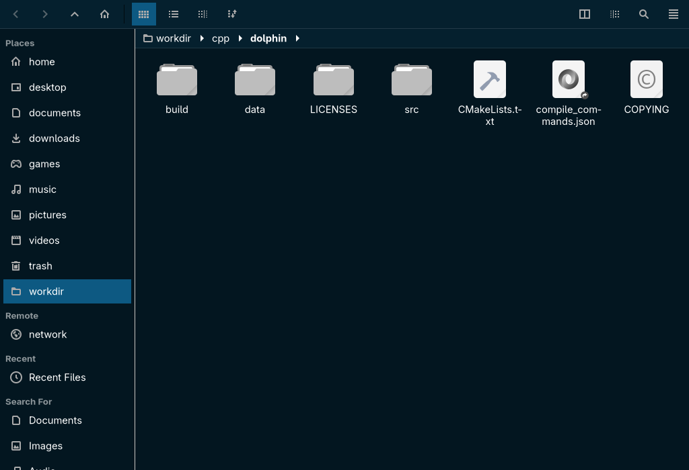
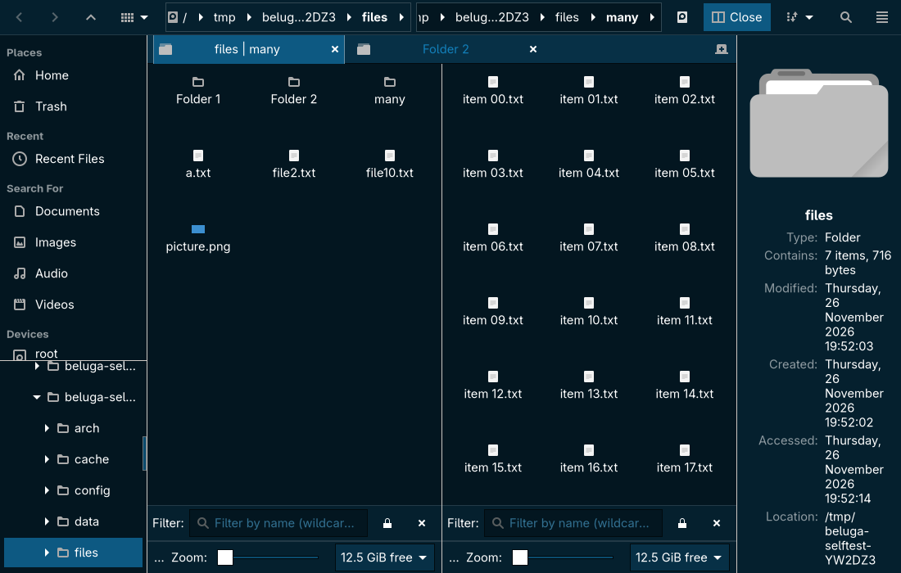

# Beluga


A file manager for Linux written in C++ with plain GTK 4. It is a rewrite of KDE's Dolphin: the same views,
panels, tabs, split view and shortcuts, without Qt, KDE Frameworks or libadwaita.

Beluga contains no Dolphin code. Settings that KDE kept in System Settings (click behaviour, terminal, trash
limits, places) live in Beluga's own preferences.



## List of Contents

- **[Parts](#parts)**
- **[Features](#features)**
- **[Requirements](#requirements)**
- **[Installation](#installation)**
  - [Building](#building)
- **[Quick start](#quick-start)**
  - [Command line](#command-line)
  - [Keyboard shortcuts](#keyboard-shortcuts)
- **[Coming from Dolphin](#coming-from-dolphin)**
- **[Settings](#settings)**
- **[Testing](#testing)**
- **[Translating](#translating)**
- **[Known limitations](#known-limitations)**
- **[License](#license)**

## Parts

| Part | Binary / file | Use it for |
|---|---|---|
| File manager | `beluga` | browsing and managing files |
| Engine | `belugacore` (static library) | file operations, trash, search, previews, places, devices, settings (GLib/GIO only) |
| Desktop entry | `org.beluga.Beluga.desktop` | launchers and "open folder" from other apps |

## Features

- **Views**: Icons, Compact, Details and Columns (<kbd>Ctrl</kbd>+<kbd>1</kbd>–<kbd>4</kbd>) in one virtualised
  widget, so folders with 100 000 items scroll without delay. Details has resizable columns and expandable
  folders. Columns shows each parent folder in its own column. All views can group items by name, size, date,
  type and other columns.
- **Tabs and split view**: tabs with drag-to-reorder, detach and "recently closed"; two views side by side
  (<kbd>F3</kbd>) with copy/move to the other view (<kbd>Shift</kbd>+<kbd>F5</kbd> / <kbd>F6</kbd>).
- **Panels**: Places (<kbd>F9</kbd>), Folders tree (<kbd>F7</kbd>) and Information (<kbd>F11</kbd>, with
  previews, image dimensions, audio/video duration and playback, and folder sizes).
- **File operations**: copy, move, link, rename (inline or batch with `#` numbering), duplicate, trash and delete
  run in worker threads with a progress button in the tool bar, conflict dialogs (skip, overwrite, rename, write
  into) and undo/redo.
- **Trash without gvfs**: browse, restore and empty the freedesktop.org trash, including trash folders on other
  drives. Optional age and size limits.
- **Search without an indexer**: by name (wildcards work), by text content, file type and modification date, from
  the current folder, your home folder or everywhere. Results stream in while the search runs.
- **Previews**: the shared freedesktop thumbnail cache, filled by gdk-pixbuf, the system's `.thumbnailer`
  programs and Tumbler when installed.
- **Devices**: drives and partitions from UDisks2 with usage bars, mount, unmount and safe removal.
- **Terminal**: <kbd>F4</kbd> opens your terminal in the current folder. The command is a Beluga setting; when it
  is empty Beluga uses `$TERMINAL` or the first installed terminal it knows (kitty, foot, alacritty, …).
- **Custom actions**: your own context menu entries (name, icon, command with `%f %F %n %d` placeholders, file
  patterns and types). They replace KDE service menus. "Extract Here" and "Compress to .tar.gz" are included.
- **Integration**: drag and drop with other apps, a clipboard other GTK and KDE file managers understand, and the
  `org.freedesktop.FileManager1` D-Bus service browsers use for "Show in folder".
- **Translations**: 61 languages, about 40% of the messages each, taken from Dolphin, KDE Frameworks and GTK
  where the English text is the same. The rest is shown in English.
- **Look**: colours come from your GTK theme's named colours (pywal and Noctalia style sheets work), square
  corners, no titlebar of its own.



## Requirements

- GTK 4.16 or newer, GLib 2.84 or newer, gdk-pixbuf
- To build: a C++17 compiler, CMake 3.16, pkg-config, gettext (`msgfmt`, for the translations)
- Optional at run time: UDisks2 (devices), Tumbler or `.thumbnailer` programs (video/PDF previews), gvfs
  (network locations such as `sftp://`), `bsdtar` (the "Extract Here" action)

## Installation

| Package | Contents |
|---|---|
| [`beluga-bin`](https://aur.archlinux.org/packages/beluga-bin) | the release binary from GitHub |
| [`beluga-git`](https://aur.archlinux.org/packages/beluga-git) | built from the latest commit |

Other distributions: download `beluga-<version>-linux-x86_64.tar.gz` from the
[releases](https://github.com/TheElevatedOne/beluga/releases) and copy its `bin/` and `share/` folders into `/usr`
or `~/.local`, or build it.

### Building

```sh
# Arch:   sudo pacman -S base-devel cmake gtk4 gettext
# Debian: sudo apt install build-essential cmake pkg-config gettext libgtk-4-dev
# Fedora: sudo dnf install gcc-c++ cmake gettext gtk4-devel
cmake -S . -B build -DCMAKE_BUILD_TYPE=Release
cmake --build build
sudo cmake --install build
```

`-DBELUGA_INSTALL_FILEMANAGER1_SERVICE=ON` also installs a D-Bus service file, so "Show in folder" starts Beluga when it
isn't running. Leave it off if another file manager should own that service.

## Quick start

Run `beluga` to open your home folder (or the tabs of your last session). Run `beluga ~/Downloads` to open a folder,
or `beluga --select ~/Downloads/file.zip` to open its folder with the file selected.

### Command line

```text
Usage:
  beluga [OPTION…] [FILE or FOLDER…]

Application Options:
  -s, --select              Select the given files in their folders
  --split                   Open the window in split view
  --new-window              Always open a new window
  --daemon                  Keep running in the background for the FileManager1 D-Bus service
  -v, --version             Show the version
```

A second `beluga` call opens a new window in the running instance, or a new tab when **Configure Beluga → General →
Open folders from other applications in a new tab** is on.

### Keyboard shortcuts

| Keys | Action |
|---|---|
| <kbd>F2</kbd> / <kbd>Del</kbd> / <kbd>Shift</kbd>+<kbd>Del</kbd> | rename / move to trash / delete |
| <kbd>F3</kbd> / <kbd>F4</kbd> | split view / open terminal |
| <kbd>F5</kbd> / <kbd>F6</kbd> / <kbd>Ctrl</kbd>+<kbd>L</kbd> | reload / editable location / replace location |
| <kbd>Ctrl</kbd>+<kbd>1</kbd> … <kbd>Ctrl</kbd>+<kbd>4</kbd> | Icons / Compact / Details / Columns view |
| <kbd>F7</kbd> / <kbd>F9</kbd> / <kbd>F11</kbd> | Folders / Places / Information panel |
| <kbd>F10</kbd> | new folder |
| <kbd>Ctrl</kbd>+<kbd>I</kbd> or <kbd>/</kbd> / <kbd>Ctrl</kbd>+<kbd>F</kbd> | filter bar / search |
| <kbd>Ctrl</kbd>+<kbd>H</kbd> | show hidden files |
| <kbd>Ctrl</kbd>+<kbd>T</kbd> / <kbd>Ctrl</kbd>+<kbd>W</kbd> / <kbd>Ctrl</kbd>+<kbd>Shift</kbd>+<kbd>T</kbd> | new tab / close tab / reopen closed tab |
| <kbd>Space</kbd> | selection mode |
| <kbd>Alt</kbd>+<kbd>←</kbd> / <kbd>Backspace</kbd> / <kbd>Alt</kbd>+<kbd>↑</kbd> | back / back / up |
| <kbd>Ctrl</kbd>+<kbd>M</kbd> | show the menu bar |
| <kbd>Ctrl</kbd>+<kbd>Shift</kbd>+<kbd>,</kbd> | Configure Beluga |

Every shortcut can be changed in **Configure Beluga → Keyboard Shortcuts**. Typing a name in a view jumps to the
first matching item.

## Coming from Dolphin

- **Removed**: the embedded Konsole panel, the Help menu, KDE-only actions (KFind, Kompare, Filelight, activities,
  stash, "Act as Administrator", Get New Stuff), Baloo tags/ratings/comments, version control plugins and
  browsing inside archives.
- **Moved into Beluga**: single/double click behaviour, the terminal command, trash limits, places and keyboard
  shortcuts.
- **Places**: on the first start Beluga copies your entries from `~/.local/share/user-places.xbel` (Dolphin's
  places) or GTK bookmarks. After that it keeps its own list.
- **View properties** are stored in Beluga's data folder instead of `.directory` files inside your folders.

## Settings

Beluga creates its files the first time it needs them. Everything can be changed in **Configure Beluga**
(<kbd>Ctrl</kbd>+<kbd>Shift</kbd>+<kbd>,</kbd>).

| File | Contents |
|---|---|
| `~/.config/beluga/beluga.conf` | all settings and custom shortcuts |
| `~/.config/beluga/places.conf` | the Places panel |
| `~/.config/beluga/actions.conf` | custom context menu actions |
| `~/.local/share/beluga/viewprops.conf` | view mode, sorting and columns, globally or per folder |
| `~/.local/state/beluga/session.conf` | open windows and tabs, when **Remember open folders and tabs** is on |

## Testing

`beluga --selftest` runs 42 checks of the file operation engine (copy, move, conflicts, trash and restore, undo,
rename, search, sorting, places) and of the window (all four views, filter, navigation, split view, tabs, search,
trash, the menu actions and the dialogs they open, preferences). It uses a temporary folder and a throwaway profile, so your settings, places and trash are not
touched. Add `--screenshots DIR` to save PNGs of each view.

To run it without opening a window, use GTK's offscreen Broadway backend:

```sh
gtk4-broadwayd :5 &
GDK_BACKEND=broadway BROADWAY_DISPLAY=:5 ./build/beluga --selftest --screenshots /tmp/beluga-shots
```

## Translating

The messages are in `po/beluga.pot` (gettext domain `beluga`). To translate Beluga into a language, copy it to
`po/<language>.po`, fill in the `msgstr` lines and build; CMake compiles every `po/*.po` file. After changing
strings in the code, run `cmake --build build --target pot` and `msgmerge -U po/<language>.po po/beluga.pot`.

`po/import-kde-translations.py` made the first version of each file from Dolphin's translations in this
repository's history and the KDE Frameworks and GTK catalogs installed on the machine that ran it.

## Known limitations

- Translations cover about 40% of the messages.
- No browsing inside archives (`.zip`, `.tar.gz`, …). Use **Extract Here**.
- Network locations (`sftp://`, `smb://`, `network:///`) need gvfs.
- Search reads the disk every time. Content search reads text files up to 64 MiB and skips binary files, so it
  does not find text inside PDFs or office documents.
- The Information panel shows image dimensions and audio/video duration, but no tags (artist, album, camera, …).

## License

GPL-2.0-or-later, see [COPYING](COPYING).
